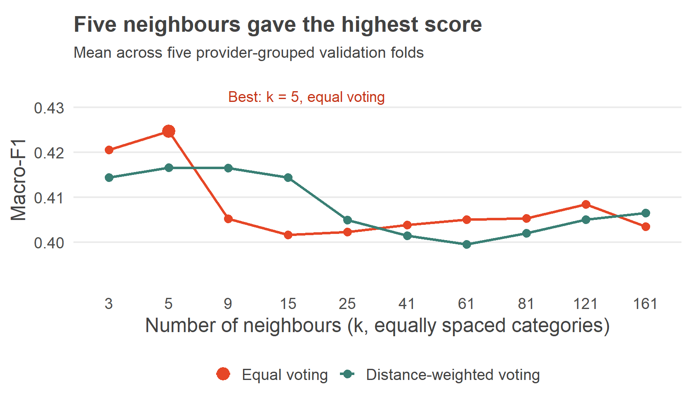
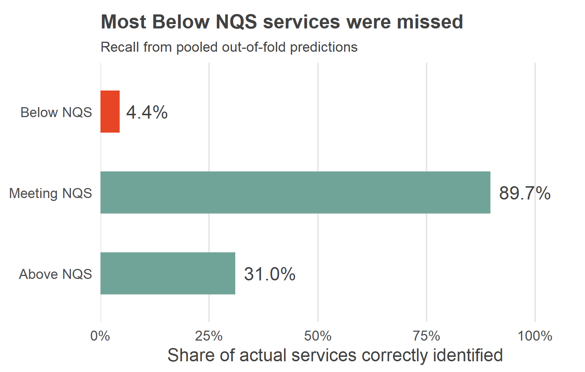

## KNN: learning from similar services {#knn-method .knn-slide}

::: {.columns}
::: {.column width="39%"}

### How it works

Find services with similar profiles, then let their rating tiers vote.

- Standardise numerical features so units do not dominate distance.
- Keep each provider's services together in all five validation folds.
- Compare 10 neighbour counts and two voting rules.

**Selected: 5 neighbours, equal voting**

:::
::: {.column width="61%"}

{fig-alt="Mean five-fold Macro-F1 for all 20 KNN configurations. Equal voting with five neighbours has the highest score, 0.425." width=100%}

::: {.knn-caption}
Macro-F1 gives each rating tier equal weight. Meeting NQS accounts for 74.3% of labelled services in A1.

Figure redrawn from the same cross-validation results as the report (cv_summary.csv).
:::

:::
:::

::: {.notes}
Timing: approximately 40 seconds.

KNN predicts a service's rating by finding similar services and letting their ratings vote. Because it uses distances, we standardised numerical features so their units would not dominate. We compared ten neighbour counts and two voting rules using the same five validation folds as the other models. All services from one provider stayed together, and preprocessing used only each fold's training data. We selected five neighbours with equal voting because this gave the highest mean Macro-F1. This measure gives each tier equal weight, which matters because Meeting NQS dominates our data.

Technical details for questions: k = 3, 5, 9, 15, 25, 41, 61, 81, 121, 161. kknn rectangular and triangular kernels, Euclidean distance = 2, engine scale = FALSE. Mean fold Macro-F1 0.4246294308, fold SD 0.0247450901. Best distance-weighted result: k = 5, Macro-F1 0.4166167421. Differences are descriptive and have not been tested for statistical significance. Fold-wise preprocessing includes missing/novel category handling, rare-level pooling, median imputation, log1p provider count, numeric scaling, dummy encoding and near-zero-variance filtering. No class resampling or class weighting was applied. Providers do not overlap across fold boundaries. The grouped design targets performance for providers outside the training partition, rather than extra services of providers already seen.

Sources: Group 2 outputs/knn/cv_summary.csv and Assignment 1 class distribution. Implementation: R/07_knn.R and shared R/06_model_setup.R. Template adapted from Januar Harianto / usyd-soles-edu, https://github.com/usyd-soles-edu/soles-revealjs, CC BY 4.0, https://creativecommons.org/licenses/by/4.0/. Adaptations: KNN content, figures and scoped layout CSS.
:::

## KNN improves Macro-F1 but misses most Below NQS services {#knn-results .knn-slide}

::: {.columns}
::: {.column width="43%"}

### Performance against the baseline

| Mean across five folds | Majority baseline | KNN |
|:---|---:|---:|
| Macro-F1 | 0.283 | **0.425** |
| Accuracy | 73.72% | 72.24% |

The baseline always predicts Meeting NQS.

**Only 45 of 1,016 Below NQS services were identified.**

KNN offers limited support for identifying services below the standard.

:::
::: {.column width="57%"}

{fig-alt="Recall from pooled out-of-fold predictions: Below NQS 4.4 percent, Meeting NQS 89.7 percent, Above NQS 31.0 percent." width=100%}

:::
:::

::: {.knn-caption}
Training-set cross-validation only. Tuning and evaluation share the same folds, so estimates may be optimistic. The held-out test set remains unused by this KNN contribution.

Recall chart redrawn from the report's pooled out-of-fold confusion matrix (class_metrics.csv; confusion_matrix.csv).
:::

::: {.notes}
Timing: approximately 40 seconds.

Compared with always predicting Meeting NQS, KNN increased Macro-F1 from zero point two eight three to zero point four two five, although accuracy fell slightly. The class results explain this trade-off. KNN recognised almost ninety percent of Meeting services, but only four point four percent of Below services, just forty-five out of one thousand and sixteen. So it learned some useful patterns, but offers limited support for identifying services below the standard. These are internal cross-validation results and may be optimistic because we used the same folds for tuning. We still need the common model comparison before choosing the group's final model.

Metric definitions: Macro-F1 is the arithmetic mean of three class-specific F1 scores, and F1 combines precision and recall. Recall is the proportion of actual services in a tier that the model correctly identifies. Table numbers are unweighted means across folds. Chart numbers pool selected-configuration out-of-fold predictions and therefore use a different aggregation. Pooled Macro-F1 = 0.4244192004 and pooled accuracy = 0.7230495666. Below: 45/1016. Meeting: 8930/9954. Above: 784/2527. A higher Macro-F1 does not imply adequate minority-class performance. The majority baseline has zero recall in both minority classes. KNN's gain over it is not an estimate of the benefit from tuning alone. No test predictions were used here. Avoid claims of causal effects or future rating prediction from this administrative snapshot.

Sources: Group 2 outputs/knn/baseline_cv.csv, cv_summary.csv, class_metrics.csv and confusion_matrix.csv. Chart reproduces saved pooled validation results. Presenter handoff: the next speaker can compare this candidate with the other models using the same mean-fold Macro-F1 criterion.
:::
