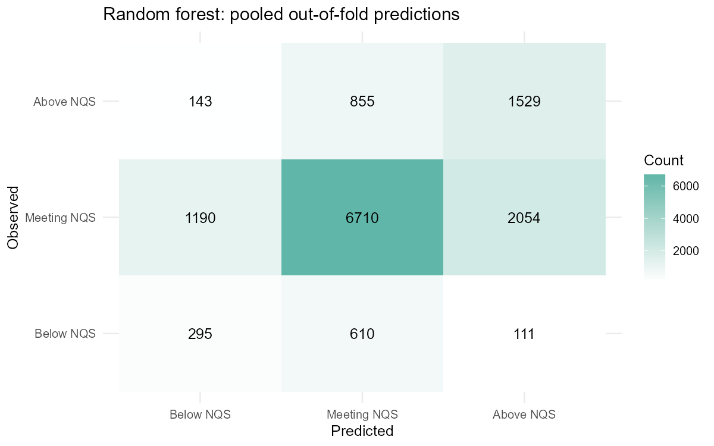

## Random Forest: method and tuning {#rf-method}

::: {.columns}
::: {.column width="47%"}

### Why Random Forest?

- Combines many decision trees to predict the three rating tiers.
- Can learn nonlinear patterns and interactions between service features.
- Numerical features do not need scaling.

### Fair comparison

Same five provider-grouped folds; preprocessing fitted within each training fold.

:::
::: {.column width="53%"}

### Eight settings compared

| Setting | Values tested | Selected |
|:---|:---|:---|
| Features per split | 5, 12 | **5** |
| Minimum node size | 5, 20 | **20** |
| Class weights | Uniform, balanced | **Balanced** |
| Trees | 500 (fixed) | **500** |

Selected using the highest **mean cross-validation Macro-F1**.

Balanced weights give more weight to smaller classes.

:::
:::

::: {.notes}
My part is Random Forest. It combines many decision trees to predict the three quality levels. It can learn patterns that are not simple straight lines. I tried eight settings using the same five validation folds as the group. Services from the same provider stayed together. The best setting used five features at each split, a minimum node size of twenty, and balanced class weights. All settings used five hundred trees.

Technical details: ranger; gini split rule; mtry = 5; min.node.size = 20; inverse-frequency weights calculated using each fold's training data. The shared tree recipe handles missing and categorical values without numeric scaling. There are 2 x 2 x 2 = 8 configurations. Selection is based on unweighted mean fold Macro-F1, not training accuracy or test performance.

Sources: R/07_random_forest.R; R/06_model_setup.R; outputs/random_forest/tuning_grid.csv and cv_summary.csv. Theme: SOLES reveal.js template by Januar Harianto, https://github.com/usyd-soles-edu/soles-revealjs. This contribution uses the group's existing theme and adds RF content.
:::

## Random Forest: validation results {#rf-results}

::: {.columns}
::: {.column width="43%"}

| Mean across five folds | Baseline | RF |
|:---|---:|---:|
| Macro-F1 | 0.283 | **0.482** |
| Accuracy | 73.72% | 63.02% |

Baseline: always predict Meeting NQS.

**295 of 1,016 Below NQS services identified (29.0%).**

Higher Macro-F1, but lower overall accuracy. Most Below NQS services are still missed.

:::
::: {.column width="57%"}

{fig-alt="Pooled validation confusion matrix. Correct predictions: 295 Below NQS, 6710 Meeting NQS, and 1529 Above NQS." width=100%}

:::
:::

::: {style="font-size: 0.75em;"}
Cross-validation results, not test results. Using the same folds for tuning and scoring may give optimistic estimates.
:::

::: {.notes}
The average Macro-F1 score was about zero point four eight, compared with zero point two eight for the baseline. Accuracy was about sixty-three percent. So the model gave a better balance across the three classes, but lower overall accuracy. It found only twenty-nine percent of Below NQS services, so this is still a weakness. These are cross-validation results, not final test results.

The two spoken paragraphs together are approximately one minute at a clear, steady pace; technical details are for questions, not for reading aloud.

Mean fold Macro-F1 = 0.4824645364, SD = 0.0265381067; mean accuracy = 0.6301849101. Baseline values are means from baseline_cv.csv. The image pools out-of-fold predictions, whereas the table averages fold metrics. Pooled class recall: Below 295/1016 = 29.0%; Meeting 6710/9954 = 67.4%; Above 1529/2527 = 60.5%. Balanced class weights alone are not proven to cause the gain: other settings also differ. No held-out test performance is claimed. RF has not been declared the group's selected final model.

Sources: outputs/random_forest/cv_summary.csv, baseline_cv.csv, per_class_metrics.csv, confusion_matrix.csv; figures/random_forest/confusion_matrix.png. The existing report figure is reused without altering its numbers.
:::
