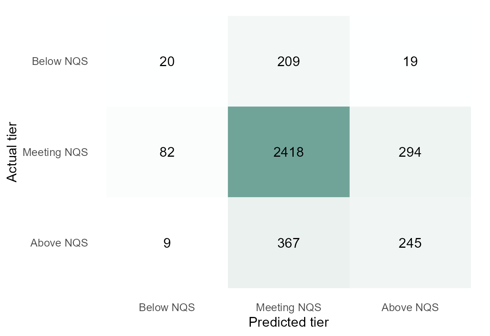

## Selected model: MLR test results {#selected-model-results}

**MLR selected by shared-fold CV:** Macro-F1 **0.487**, versus RF **0.482** (a small gap).

::: {.columns}
::: {.column width="44%"}

### Results on 3,663 test services

| Metric | Baseline | MLR |
|:---|---:|---:|
| Macro-F1 | 0.288 | **0.454** |
| Accuracy | 76.28% | 73.25% |

Baseline always predicts Meeting NQS.

**Below NQS recall: 8.1% (20/248).**

Better balance across tiers, but most Below NQS services are missed.

:::
::: {.column width="56%"}

{fig-alt="Test confusion matrix for corrected MLR: 20 of 248 Below NQS, 2418 of 2794 Meeting NQS, and 245 of 621 Above NQS services classified correctly." width=100%}

:::
:::

::: {style="font-size: 0.75em;"}
No train/test provider overlap in this refit. Earlier project work exposed this test partition, so it is not a pristine independent confirmation.
:::

::: {.notes}
After using the same data split, MLR had the highest average validation score, but it was only slightly ahead of Random Forest. We then tested it on three thousand six hundred and sixty-three services. Its Macro-F1 was about zero point four five, and its accuracy was about seventy-three percent. However, it found only twenty of the two hundred and forty-eight Below NQS services. So it still misses most services below the standard. This model kept training and test providers separate, but earlier project work had already used some of the test data. We should treat these results with caution.

Technical details for questions: ridge multinomial logistic regression, alpha = 0, lambda = 0.001, square-root inverse-frequency training weights. Original lambda grid and three weight schemes retained. All five shared provider-grouped CV folds matched exactly. Corrected mean CV Macro-F1 = 0.4871153 (SD 0.018007), mean accuracy = 0.7255151. RF mean Macro-F1 = 0.4824645, gap = 0.0046508; no statistical superiority is claimed. Select the model and parameters by CV, not by these test results.

Test Macro-F1 = 0.4541829; accuracy = 0.7324597. Test recall: Below 0.0806452, Meeting 0.8654259, Above 0.3945250. Baseline Macro-F1 = 0.2884725; accuracy = 0.7627628. Training: 13,497 services / 5,509 providers. Test: 3,663 services / 1,376 providers. Zero provider overlap in this corrected fit. Preprocessing and weights fitted using training data only.

Project-level caveat: the original MLR split put 3,194 services from the shared test partition in its training data, and the LDA contribution also evaluated the shared test data. Refitting does not undo prior project exposure or create a fresh external test. Do not call this the first use of the test set, or an unbiased final confirmation. No further tuning was performed after reading these test results.

Sources: outputs/selected_model/comparison_summary.csv, test_metrics.csv, test_class_metrics.csv, test_confusion_matrix.csv, evaluation_audit.csv; outputs/mlr_shared/split_audit.csv. Implementation: R/11_mlr_shared_split.R and R/12_selected_model_test.R, reusing Wilson's MLR functions. Theme: SOLES reveal.js template by Januar Harianto, https://github.com/usyd-soles-edu/soles-revealjs.
:::
