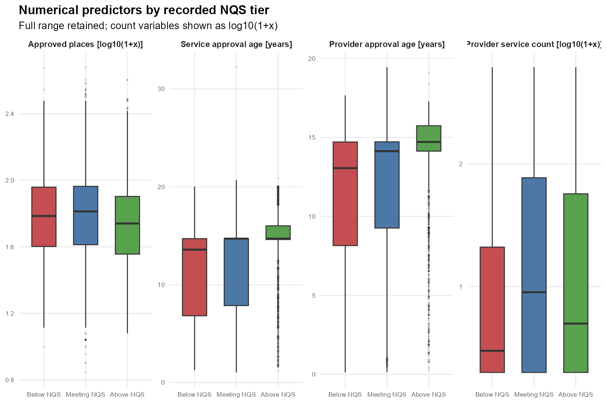

## Problem, Data and Key EDA {.problem-eda}

**Research question:** Can service, operating, geographic and provider characteristics classify an Australian education and care service's recorded NQS rating tier?

:::: {.columns}

::: {.column width="38%"}

### Data

- ACECQA National Registers
- **17,160** services; **6,885** providers
- **28** predictors; **3** rating tiers

| Rating tier | Share |
|---|---:|
| Below NQS | 7.4% |
| Meeting NQS | **74.3%** |
| Above NQS | 18.3% |

:::

::: {.column width="62%"}

{width=100% fig-alt="Distributions of four numerical predictors across the three recorded NQS rating tiers"}

:::

::::

### Key EDA

- The three rating tiers are strongly imbalanced.
- Numerical predictors overlap substantially across rating tiers.

::: {.notes}
Our research question asks whether service, operating, geographic and provider characteristics can classify a service's recorded NQS rating tier. The data contain 17,160 labelled services from 6,885 providers and 28 candidate predictors. Meeting NQS accounts for approximately 74 percent of services, creating substantial class imbalance. The numerical predictors also overlap considerably across tiers, so no individual variable provides clear separation. These findings motivated Macro-F1 evaluation and comparison of several classification models.
:::