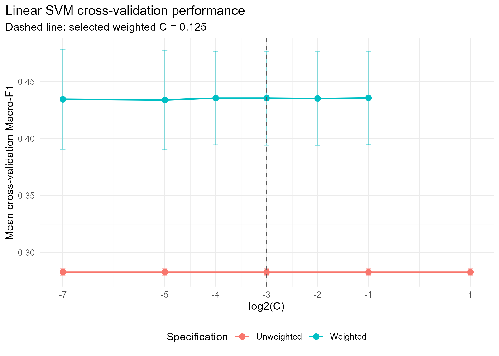
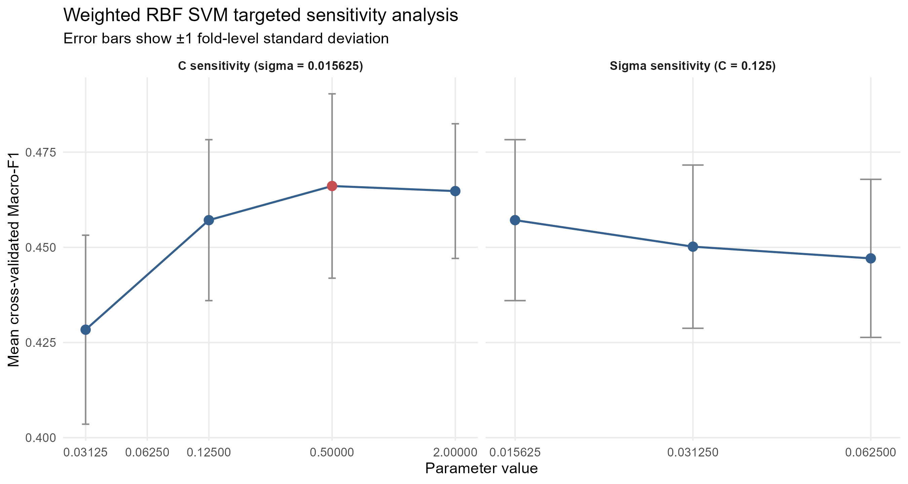

## Linear SVM: effect of class weighting

::: {.columns}

::: {.column width="68%"}

{width=100% fig-alt="Cross-validation Macro-F1 for weighted and unweighted Linear SVM across cost values"}

:::

::: {.column width="32%"}

### Key results

| Specification | Macro-F1 | Minority recall |
|---|---:|---:|
| Unweighted | 0.283 | 0.000 / 0.000 |
| Weighted | **0.435** | 0.043 / 0.472 |

<small>Minority recall: Below NQS / Above NQS</small>

- The unweighted model predicted only Meeting NQS.
- Class weighting prevented majority-class collapse.
- We selected $C = 0.125$ because performance was stable across weighted values.

:::

:::

::: {.notes}
The unweighted Linear SVM predicted every service as Meeting NQS, and changing the cost parameter did not solve this problem. We therefore introduced square-root inverse-frequency class weights. This increased Macro-F1 from 0.283 to 0.435 and enabled the model to identify some minority-class observations. Because performance was nearly constant across the weighted cost values, we selected C equals 0.125 as the more strongly regularised specification.
:::

## RBF SVM: nonlinear refinement

::: {.columns}

::: {.column width="68%"}

{width=100% fig-alt="Targeted sensitivity analysis for cost and sigma in the weighted RBF SVM"}

**Selected RBF parameters:** $C = 0.5$, $\sigma = 0.015625$

:::

::: {.column width="32%"}

### Model comparison

| Metric | Linear | RBF |
|---|---:|---:|
| Macro-F1 | 0.435 | **0.466** |
| Accuracy | 0.706 | **0.731** |
| Below recall | 0.043 | **0.084** |
| Above recall | **0.472** | 0.402 |

- RBF achieved the highest SVM Macro-F1.
- Below NQS recall improved, but remained low.

:::

:::

::: {.notes}
We next tested an RBF kernel to allow nonlinear decision boundaries. Targeted tuning first compared sigma values and then cost values at the selected sigma. The selected RBF model increased Macro-F1 to 0.466 and approximately doubled Below NQS recall. However, Above NQS recall decreased, and the model still identified relatively few Below NQS services.
:::