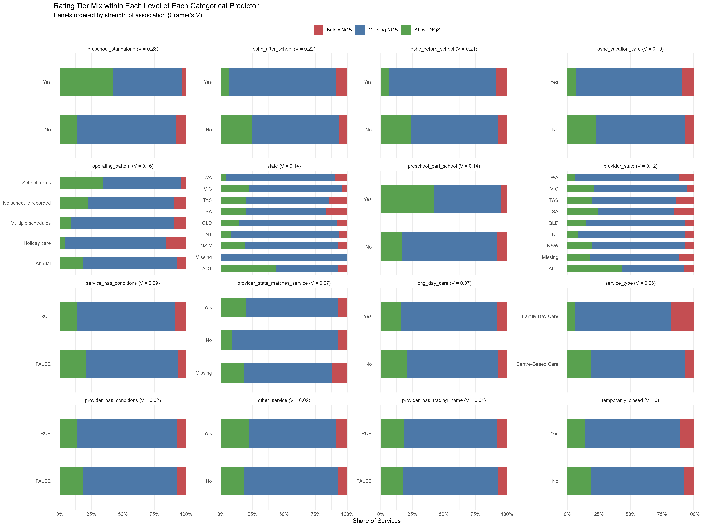
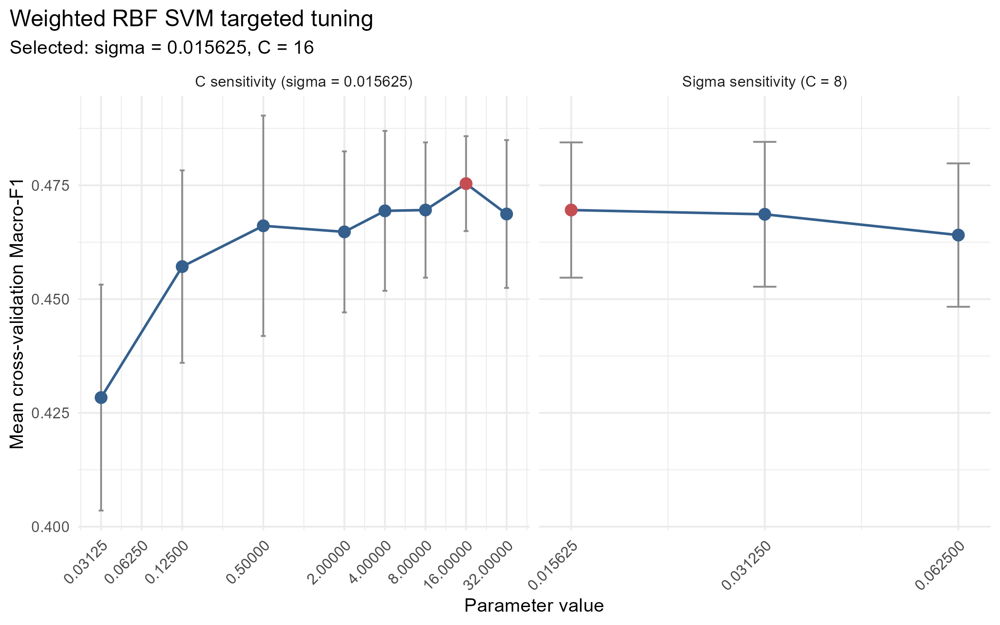
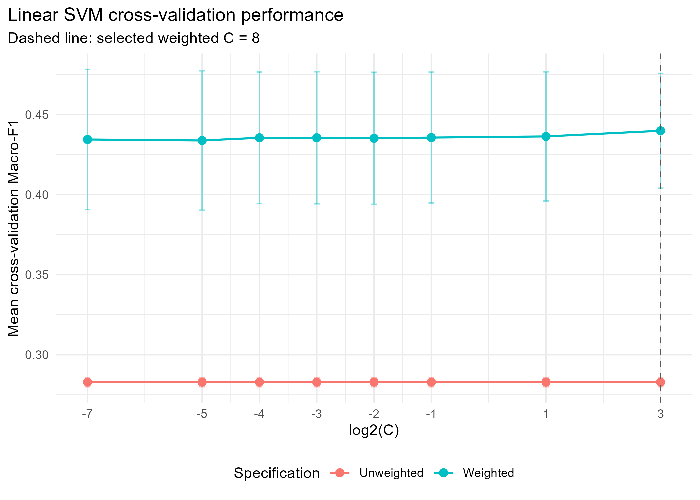

<style>
#exploratory-data-analysis-eda .quarto-layout-row {
  display: flex !important;
  flex-wrap: nowrap !important;
  justify-content: center;
  gap: 12px;
}
#exploratory-data-analysis-eda .quarto-layout-cell {
  flex: 0 1 300px !important;
  width: 50% !important;
  min-width: 0 !important;
}
#exploratory-data-analysis-eda .quarto-layout-cell img {
  display: block;
  width: 100% !important;
  max-width: 300px !important;
  height: auto !important;
  margin: auto;
}
@media print {
  #exploratory-data-analysis-eda .quarto-layout-row { display: flex !important; flex-wrap: nowrap !important; }
  #exploratory-data-analysis-eda .quarto-layout-cell { width: 48% !important; }
}
</style>

```{r libraries, echo=FALSE, warning=FALSE, message=FALSE}
library(readr)
library(dplyr)
library(caret)
library(recipes)
library(ggplot2)
select <- dplyr::select
```


# Introduction

Australian education and care services are assessed against the National Quality Standard (NQS) under the National Quality Framework. The assessment process supports service quality and continuous improvement (https://www.acecqa.gov.au/assessment/assessment-and-rating-process). The Australian Children’s Education & Care Quality Authority (ACECQA) also publishes national registers containing information about services and providers (https://www.acecqa.gov.au/resources/national-registers). Examining these records may provide useful information for regulatory planning, service improvement and policy research.

# Problem Framing & Research Question

This project is a multi-class classification task. Each observation represents an education and care service, and the outcome is its recorded NQS rating tier: Below NQS, Meeting NQS or Above NQS. Model predictions may support further investigation, but they cannot replace formal NQS assessments or establish causal relationships.

The research question is:

> To what extent can service type, service capacity, operating patterns, geographic location, and provider characteristics be used to classify an Australian education and care service’s recorded NQS rating tier as Below NQS, Meeting NQS, or Above NQS?


# Dataset & Justification

```{r dataset-checks, results='hide'}
source_dimensions <- read.csv('../outputs/source_dimensions.csv')
linkage_checks <- read.csv('../data/processed/acecqa_linkage_summary.csv')
analysis_data <- read.csv('../data/processed/acecqa_analysis.csv')
stopifnot(linkage_checks$value[linkage_checks$measure == 'Service rows unmatched to provider register'] == 0,
          !anyDuplicated(analysis_data$service_id),
          nrow(analysis_data) == 17160)
```

This project used two ACECQA national registers downloaded on 18 September 2026: the Education services register and the Approved providers register (https://www.acecqa.gov.au/resources/national-registers). The services register contained 18,183 records and 98 variables, meeting the Large dataset requirement. The providers register contained 10,095 records and 10 variables. Missing ratings, capacity and operating schedules also made the data Messy.

Each observation represented a service. The two registers were linked by Provider Approval Number, meeting the Integrated dataset requirement. IDs were unique in their respective registers, and every service was matched to a provider. After removing 1,023 services without a rating, the final dataset contained 17,160 services from 6,885 providers and 28 candidate predictors. Ratings were grouped into three classes, meeting the Multi-class requirement: Significant Improvement Required and Working Towards NQS became Below NQS; Meeting NQS remained unchanged; and Exceeding NQS and Excellent became Above NQS.

# Exploratory Data Analysis (EDA)

## NQS Rating Distribution and Missing Values
The rating tiers were imbalanced: 74.3% of services were Meeting NQS, while 7.4% were Below NQS and 18.3% were Above NQS.

Missingness was high for schedule-specific weekly hours and may be related to which schedules a service offered. Approved capacity was missing for all 307 Family Day Care services. Maximum weekly hours were missing for 142 services; all recorded values were within 168 hours per week.

```{r eda-distribution, fig.show='hold', out.width='49%'}
#| layout-ncol: 2
rating_distribution <- read.csv('../outputs/rating_distribution.csv')
missingness <- read.csv('../outputs/missingness_selected.csv')
knitr::include_graphics(c('../figures/rating_tier_distribution.png',
                          '../figures/missingness_selected.png'))
```

*Rating-tier distribution and missingness in selected variables.*

## Categorical Variables

Centre-Based Care represented 98.2% of services. Standalone preschool, OSHC services, operating pattern and state showed the clearest relationships with rating tier. Standalone preschools and services without OSHC had a higher proportion of Above NQS ratings, although the groups still overlapped. The three OSHC variables were also strongly related to each other, and service state and provider state often contained similar information.

```{r eda-categorical, out.height='50%', fig.align='center'}
categorical_counts <- read.csv('../outputs/categorical/categorical_vs_rating_crosstab.csv')

```

## Numerical and Operating Variables

Capacity and approval ages differed across rating tiers, but their distributions overlapped. Provider service count was strongly right-skewed: across service records, the median was 7 and the maximum was 611. Operating hours also differed by rating tier and service type. The Family Day Care group included only 18 Above NQS services, so comparisons within this group were less reliable. Most services (92.4%) recorded five open days per week.

```{r eda-numerical, fig.show='hold', out.width='49%'}
#| layout-ncol: 2
numerical_summary <- read.csv('../outputs/numerical/by_tier.csv')
operating_summary <- read.csv('../outputs/operating/operating_by_tier.csv')
knitr::include_graphics(c('../figures/numerical_by_rating.png',
                          '../figures/operating_hours_by_rating.png'))
```

*Numerical predictors and weekly operating hours by rating tier.*

No single predictor clearly separated Below NQS, Meeting NQS and Above NQS services.

# Data Preprocessing

## Data Preparation and Splitting

Before splitting, approval dates and operating records were used to create age and operating-pattern variables. We also calculated provider service count and whether provider and service states matched. Service and provider IDs, the original rating and other rating-derived variables were excluded from model inputs.

Because a provider may operate several services, we split the data by provider, with approximately 80% for training and 20% for testing. The training set contained 13,497 services from 5,509 providers; the test set contained 3,663 services from 1,376 providers. Each provider's most common rating tier was used for approximate stratification. Five-fold cross-validation also kept services from the same provider together. Preprocessing values were calculated using each fold's training data and then applied to its validation data.

## Preprocessing Recipes

Missing values in numerical variables were replaced with the median calculated from the current training data. No separate missingness indicators were created for structural missing values. Missing values in categorical variables were labelled as Unknown. Categories that appeared for the first time in validation or test data were labelled as Novel. Categories representing less than 1% of the training data were grouped as Other.

Logical variables were converted to No/Yes categories, categorical variables were dummy encoded, and predictors with no or very little variation were removed.

kNN and SVM used the shared scaled recipe, which applied a $\log(x+1)$ transformation to provider_service_count and normalised numerical predictors. LDA used the same recipe and additionally removed linear combinations and numerical predictors with correlations above 0.9. Random Forest used the tree recipe, which also applied the log transformation but did not normalise numerical predictors.

MLR used a separate recipe with 19 selected predictors, normalisation and zero-variance removal. It did not apply the $\log(x+1)$ transformation to provider_service_count. Detailed code as follows.

```{r preprocessing-source, code=readLines('../R/06_model_setup.R', warn=FALSE, encoding='UTF-8'), eval=FALSE, echo=TRUE}
```

# Model Fitting & Improvement

```{r shared-model-setup, include=FALSE}
local({
  previous_directory <- getwd()
  on.exit(setwd(previous_directory))
  setwd('..')
  sys.source('R/06_model_setup.R', envir=knitr::knit_global())
})
```

## Linear Discriminant Analysis

### Preprocessing

In addition to the shared `scaled_recipe`, the recipe used for Linear Discriminant Analysis (LDA) also further remove linear dependencies among numeric predictors and dropped predictors correlated above a `0.9` threshold.

```{r lda-recipe}
lda_recipe <- scaled_recipe |> # Additional pre-processing
  step_lincomb(all_numeric_predictors()) |>
  step_corr(all_numeric_predictors(), threshold = 0.9)
```


### Models

Two models of LDA were trained, one using the unchanged training set's class proportion (`lda_fit_emp`) and one using equal class priors to account for the class imbalance of the dataset (`lda_fit_equal`).

For both models, we also performed parameter tuning on `dimen` --- the number of discriminant functions produced. This is limited by the number of classes, resulting in only 2 possible tuning values.

```{r lda-model-training, message=FALSE}
lda_fit_equal <- train(
  lda_recipe,
  data = training_model_data,
  trControl = model_control,
  method = "lda2",
  metric = "Macro_F1",
  tuneGrid = expand.grid(dimen = 1:2),
  prior = rep(1/3, 3) # Equal class priors
)

lda_fit_emp <- train(
  lda_recipe,
  data = training_model_data,
  trControl = model_control,
  method = "lda2",
  metric = "Macro_F1",
  tuneGrid = expand.grid(dimen = 1:2) # Empirical priors (training class proportions)
)
```

Only one LDA model is included in the final model selection. Due to similar Macro F1 score for both models, `lda_fit_equal` was chosen due to its better Recall score for `Below NQS`

```{r lda-results}
lda_prior_comparison <- bind_rows(
  lda_fit_emp$results   |> mutate(priors = "Empirical"),
  lda_fit_equal$results |> mutate(priors = "Equal")
) |>
  select(priors, dimen, Macro_F1, Accuracy, starts_with("Recall_"))

lda_prior_comparison |>
  mutate(across(c(Macro_F1, Accuracy, starts_with("Recall_")), ~ round(.x,2))) |>
  select(1:7) |> arrange(dimen) |>
  print()
```

## kNN
```{r knn-report-setup, include=FALSE}
# Works when knitting from reports/ or from the repository root.
knn_candidates <- c(".", "..")
knn_found <- knn_candidates[file.exists(file.path(knn_candidates, "outputs", "knn", "best_parameters.csv"))]
if (!length(knn_found)) stop("Place this report in the supplied repository's reports/ directory or root.")
knn_root <- normalizePath(knn_found[1], winslash = "/")
knn_dir <- file.path(knn_root, "outputs", "knn")
```

### Model rationale and fitting

K-nearest neighbours (KNN) was included to assess whether services with similar administrative and provider profiles tend to share an NQS rating tier. The overlap between individual numerical predictors observed in EDA motivates considering their combined local structure. KNN assigns a class using nearby training observations, allowing nonlinear decision boundaries without specifying a parametric form. Below NQS, Meeting NQS and Above NQS were treated as nominal classes; their ordering was not explicitly modelled.

The common provider-grouped split contained **13,497 training services** and **3,663 held-out services**. KNN used the same five provider-grouped training folds as the other candidate models, keeping services from each provider together. This reduces leakage from shared provider characteristics and evaluates transfer to providers absent from the corresponding training partition. Identifiers and rating-derived fields were excluded.

The shared `recipes` preprocessing pipeline (Kuhn et al., 2026) handled missing and novel categorical levels, pooled levels below 1%, median-imputed numerical predictors, and log(1+x)-transformed provider service count. Numerical predictors were standardised before categorical dummy encoding, followed by near-zero-variance filtering. Scaling prevents variables measured in larger units from dominating Euclidean distances. Dummy columns were not subsequently standardised. Crucially, preprocessing parameters were estimated separately within each fold's training partition and then applied to validation data. The `kknn` engine's additional scaling was disabled (Schliep & Hechenbichler, 2025).

### Hyperparameter tuning and improvement

We compared ten neighbour counts, **k = 3, 5, 9, 15, 25, 41, 61, 81, 121 and 161**, using rectangular (equal) and triangular (distance-weighted) voting: 20 configurations across five folds. Small k permits more local variation, whereas larger k smooths the decision boundary and can favour the dominant class. Triangular voting was tested to give closer neighbours greater influence; it is not class weighting. No class rebalancing was applied. The code expands the search if the overall optimum reaches the largest k; this was unnecessary for the observed optimum.

Selection maximised the **unweighted mean fold Macro-F1**, the arithmetic mean of the three class F1 scores within each fold. This gives each tier equal evaluation weight despite Meeting NQS comprising 73.7% of training services. Exact ties were resolved by larger k, then alphabetical kernel order.

```{r knn-kernel-table, echo=FALSE}
knn_kernel <- read.csv(file.path(knn_dir, "kernel_comparison.csv"))
knn_comparison <- knn_kernel[, c("kernel", "k", "Macro_F1", "Macro_F1SD", "Accuracy")]
names(knn_comparison) <- c("Voting kernel", "Best k", "Mean Macro-F1", "Fold SD", "Mean accuracy")
knitr::kable(knn_comparison, digits = 3,
  caption = "KNN tuning: best configuration for each kernel on the five shared provider-grouped folds.")
```

The selected configuration was **k = 5, equal voting, Euclidean distance**. Its mean Macro-F1 was **0.425 (fold SD 0.025)**, compared with **0.417** for the best triangular configuration, also at k = 5. The difference of 0.008 is descriptive and does not establish statistical superiority. Triangular voting increased mean fold Below NQS recall from 0.044 to 0.067 but reduced Meeting NQS recall from 0.896 to 0.850; the pre-specified Macro-F1 rule therefore retained equal voting.

```{r knn-tuning-plot, echo=FALSE, out.width='85%', fig.cap='KNN tuning on the shared training folds. Error bars represent one fold standard deviation, not confidence intervals.'}
knitr::include_graphics(file.path(knn_root, "figures", "knn_tuning.png"))
```

### Validation results and interpretation

The majority-class baseline achieved mean fold Macro-F1 **0.283** and accuracy **0.737**. KNN improved Macro-F1 by **0.142**, while accuracy fell to **0.722**. This trade-off occurs because Macro-F1 weights classes equally, whereas accuracy is dominated by the number of Meeting NQS observations.

```{r knn-class-table, echo=FALSE}
knn_classes <- read.csv(file.path(knn_dir, "class_metrics.csv"))
names(knn_classes) <- c("Actual tier", "Support", "Precision", "Recall", "F1")
knitr::kable(knn_classes, digits = 3,
  caption = "Selected KNN: class metrics from pooled out-of-fold predictions, not held-out test predictions.")
```

Only **45 of 1,016 Below NQS services** were correctly identified (recall 0.044); **923** were classified as Meeting NQS. For Above NQS, **784 of 2,527** were identified (recall 0.310), while **1,725** were classified as Meeting NQS. Meeting NQS recall was 0.897. Thus, local profile similarity provides some classification signal but does not reliably distinguish the minority tiers. In particular, the very low Below NQS recall limits usefulness for identifying services that may require additional support or regulatory attention.

The class table pools out-of-fold predictions, giving pooled Macro-F1 **0.424**; this differs slightly from mean fold Macro-F1 **0.425** because fold sizes and distributions differ. The same folds were used for tuning and performance reporting, so these are internal estimates subject to selection optimism. **KNN was not evaluated on the held-out test set.** In the repository's common comparison, MLR achieved mean CV Macro-F1 0.487 and was selected before test scoring; KNN was therefore not the final model.

### Limitations and reproducibility

Euclidean distances remain sensitive to redundant predictors and reference-level dummy coding. Median imputation may also obscure structural missingness, and this nominal classifier does not use the tiers' ordering. Future work could compare reduced feature groups or mixed-data distances within training resampling, with particular attention to Below NQS recall. The administrative snapshot supports association-based classification, not causal claims or validated forecasts of future ratings.

All displayed results are loaded from the supplied repository outputs. To regenerate tuning results and figures, run the following from the repository root; the report itself reads saved results to avoid repeating the full search during knitting.

```{r knn-reproduce, eval=FALSE}
source("R/07_knn_install.R")
source("R/07_knn.R")
```

### Full KNN implementation

The complete KNN script is displayed below. It includes fold-wise preprocessing, hyperparameter tuning, out-of-fold evaluation, leakage checks and output generation. It depends on the shared workflow in `R/06_model_setup.R`. The code is displayed without rerunning the full search during report rendering. To regenerate the results, run `source("R/07_knn.R")` from the repository root.

```{r knn-full-source, echo=TRUE, eval=FALSE, code=readLines(file.path(knn_root, "R", "07_knn.R"), warn=FALSE)}
```

## MLR

### Model fitting and rationale

Multinomial logistic regression (MLR) was fitted as an interpretable linear model for the three rating tiers. We used ridge-regularised multinomial regression (`glmnet`, `alpha = 0`) to stabilise estimation in the presence of related service and provider characteristics. MLR used the 19-predictor recipe described in *Preprocessing Recipes*, including within-fold median imputation, missing/novel-category handling, dummy encoding, zero-variance removal and normalisation. Unlike the kNN/SVM recipe, it did not log-transform `provider_service_count`. The service and provider identifiers and rating-derived fields were excluded from model inputs.

To avoid information leakage, preprocessing was estimated separately within each training fold. As described above, all models used the provider-grouped 80/20 train/test split and five-fold provider-grouped cross-validation (CV) on the training set. The held-out test partition was not used to tune MLR.

### MLR refinement and tuning

Because **Meeting NQS accounted for 74.3%** of the services, an unweighted model could achieve high accuracy while overlooking smaller classes. We therefore assessed six ridge penalty values ($\lambda \in \{0.001, 0.003, 0.01, 0.03, 0.1, 0.3\}$) and three weighting schemes (no weights, square-root inverse-frequency weights and capped inverse-frequency weights): **18 configurations** in total. Each was evaluated on the same five provider-grouped folds, with mean **macro-F1** as the primary selection metric. The macro-F1 calculation included all three classes, assigning an F1 of zero to any class never predicted by a candidate.

The selected MLR used **$\lambda = 0.003$** and **square-root inverse-frequency class weights**. It achieved a mean CV macro-F1 of **0.4859** (SD **0.0151**) and mean CV accuracy of **72.92%**. The baseline achieved macro-F1 **0.4003** and accuracy **75.47%**. Thus, tuning improved macro-F1 by **0.0856** (approximately **21.4% relative**) at the cost of 2.55 percentage points of accuracy. This trade-off is consistent with placing more emphasis on minority rating tiers.

```{r mlr-cv-results, echo=TRUE}
# Five-fold provider-grouped CV results; all three NQS classes included in macro-F1.
mlr_cv_summary <- data.frame(
  Model = c('Unweighted baseline MLR', 'Tuned ridge MLR'),
  `Mean macro-F1` = c(0.4003, 0.4859),
  `Mean accuracy` = c(0.7547, 0.7292),
  check.names = FALSE
)
knitr::kable(mlr_cv_summary, digits = 4,
             caption = 'MLR performance on provider-grouped cross-validation (not the held-out test set).')
```

### Class-specific performance

Despite the improvement in macro-F1, the tuned model performed unevenly across the three classes. Mean CV recall was **10.2%** for Below NQS, **84.9%** for Meeting NQS and **49.3%** for Above NQS; mean class-wise F1 was approximately **0.144**, **0.827** and **0.487**, respectively. The model therefore missed most Below NQS services. Its useful overall discrimination should not be interpreted as reliable identification of potentially underperforming services.

```{r mlr-class-results, echo=TRUE}
mlr_by_class <- data.frame(
  `Rating tier` = c('Below NQS', 'Meeting NQS', 'Above NQS'),
  `Mean recall` = c(0.102, 0.849, 0.493),
  `Mean F1` = c(0.144, 0.827, 0.487),
  check.names = FALSE
)
knitr::kable(mlr_by_class, digits = 3,
             caption = 'Class-specific mean CV metrics for the selected MLR.')
```

## Random Forest

## Support Vector Machines

### Linear SVM Fitting, Tuning and Improvement
Linear SVM uses a linear decision boundary to separate the three rating tiers. It used the scaled recipe and the same five-fold provider-grouped cross-validation described earlier.

The unweighted and weighted Linear SVMs were tested using the same $C$ grid: {0.0078125, 0.03125, 0.0625, 0.125, 0.25, 0.5, 2, 8}. All unweighted Linear SVM candidates predicted every service as Meeting NQS. Their Macro-F1 and class-specific recalls were therefore almost identical to the majority-class baseline. Since $C=8$ did not improve Macro-F1 or minority-class recall compared with $C=2$, the unweighted Linear SVM search was not extended further. Under the 0.001 tie-break rule, the smallest candidate, $C=0.0078125$, was retained.

Square-root inverse-frequency class weights were then added to give more importance to errors in the two smaller classes. This prevented the Linear SVM from predicting only the majority class and increased its mean cross-validation Macro-F1 from 0.2829 to 0.4398. Within the same planned grid, the weighted Linear SVM achieved its highest mean cross-validation Macro-F1 at $C=8$. This candidate was used as the starting point for RBF refinement.

Detailed code as follows.

```{r svm-linear-source, code=readLines('../R/10_model_svm.R', warn=FALSE, encoding='UTF-8')[1:1407], eval=FALSE, echo=TRUE}
```

### RBF SVM Fitting, Tuning and Improvement

RBF SVM was considered because it can represent nonlinear relationships between the predictors and rating tiers. The selected weighted Linear SVM value, $C=8$, was first used as the anchor for sigma tuning.

Three sigma values were compared: {0.015625, 0.03125, 0.0625}. Sigma was selected using mean cross-validation Macro-F1; when results were within 0.001, the smaller sigma was preferred. This selected $\sigma=0.015625$.

With sigma fixed, the targeted $C$ grid {0.03125, 0.125, 0.5, 2, 4, 8, 16, 32} was tested. The highest mean cross-validation Macro-F1 was achieved at $C=16$, and performance decreased at $C=32$.

Detailed code as follows.

```{r svm-rbf-source, code=readLines('../R/10_model_svm.R', warn=FALSE, encoding='UTF-8')[1408:1980], eval=FALSE, echo=TRUE}
```

### SVM Results

The comparison table and RBF tuning figure below support the SVM conclusions. Detailed tuning, timing and out-of-fold diagnostics are provided in [Appendix B](#appendix-svm).

```{r svm-results, echo=FALSE}
svm_results <- read.csv('../outputs/models/svm/svm_kernel_model_comparison.csv')
svm_results <- svm_results[match(c('Unweighted Linear SVM', 'Weighted Linear SVM',
                                  'Weighted RBF SVM (targeted)'), svm_results$specification), ]
stopifnot(!anyNA(svm_results$specification))
parameters <- ifelse(is.na(svm_results$sigma),
                     paste0('C = ', svm_results$C),
                     paste0('C = ', svm_results$C, ', sigma = ', svm_results$sigma))
svm_table <- data.frame(Specification = c('Unweighted Linear', 'Weighted Linear', 'Weighted RBF'),
                        Parameters = parameters,
                        'Macro-F1' = sprintf('%.4f', svm_results$Macro_F1),
                        Accuracy = sprintf('%.4f', svm_results$Accuracy),
                        'Below recall' = sprintf('%.4f', svm_results$Recall_Below_NQS),
                        'Meeting recall' = sprintf('%.4f', svm_results$Recall_Meeting_NQS),
                        'Above recall' = sprintf('%.4f', svm_results$Recall_Above_NQS),
                        check.names = FALSE)
knitr::kable(svm_table, caption = 'Mean provider-grouped cross-validation results for SVM candidates.')
```

```{r svm-tuning-figure, echo=FALSE, out.width='60%', fig.align='center', fig.cap='Weighted RBF SVM targeted tuning.'}

```

Compared with the weighted Linear SVM, the weighted RBF SVM increased mean cross-validation Macro-F1 from 0.4398 to 0.4754 and improved Below NQS recall from 0.0428 to 0.1369. Accuracy and Above NQS recall decreased slightly, while Below NQS remained the most difficult class to identify. All SVM results were based on provider-grouped cross-validation, and the held-out test set was not used during tuning.

```{r svm-diagnostics-source, code=readLines('../R/10_model_svm.R', warn=FALSE, encoding='UTF-8')[-(1:1980)], eval=FALSE, echo=TRUE}
```

# Model Evaluation & Selection

## Selection of the final model

Following comparison of the candidate models, the group selected the **tuned ridge MLR** as its final model. Its documented training-set five-fold provider-grouped CV performance was **macro-F1 0.4859** (SD **0.0151**) with **72.92% accuracy**. Model selection was carried out without consulting the held-out test set. Other models' cross-validation comparisons and the rationale for the group decision should be finalised here by the model-comparison lead; the SVM results above are not, on their own, a complete comparison of all five candidate models.

## Interpretation and Stakeholder Insights

### Interpretation of the selected MLR

We inspected coefficients from the selected ridge MLR refitted using the **training partition only**. In the multinomial `glmnet` parameterisation, a coefficient for one class is **not** by itself an odds ratio against Meeting NQS. For a predictor $x_j$, the log-odds contrast between two classes depends on the difference between the corresponding class coefficients, $\beta_{j,A}-\beta_{j,B}$. The signs below therefore refer to **Above versus Meeting NQS** or **Below versus Meeting NQS**, holding other encoded predictors fixed.

For **Above NQS compared with Meeting NQS**, the coefficient differences were positive for service approval age (**+0.363**), provider approval age (**+0.325**) and standalone preschool status (**+0.298**), and negative for after-school-care status (**−0.499**). For **Below NQS compared with Meeting NQS**, recorded service approval conditions had a positive coefficient difference (**+0.202**), whereas provider service count had a negative difference (**−0.352**). Approval age is a proxy based on administrative dates, not necessarily operating experience. These findings describe conditional associations learned by the fitted model, **not causal effects** or a ranking of determinants of quality. Numeric features and dummy-coded indicators were processed and standardised, so the coefficients should not be interpreted as effects of a one-year increase or a raw 0-to-1 switch without accounting for the relevant scaling.

### Stakeholder implications and cautions

For **regulators**, administrative predictors may support exploratory monitoring and help identify questions for further quality-review planning. However, the MLR's **10.2% Below NQS cross-validation recall** means that most services in this tier were not identified; it is therefore **unsuitable as a stand-alone screening or compliance decision tool**. For **service providers**, the associations can stimulate quality-improvement discussions but do not show that changing a particular administrative characteristic would raise an NQS rating. For **policy researchers**, this model offers a transparent benchmark for studying associations and testing whether richer information improves minority-class identification.

Any practical use would require expert oversight, assessment of subgroup performance (including across states and service types), and validation beyond this register snapshot. Predictions should supplement, not replace, formal NQS assessment. **The held-out test results have not been supplied with this report draft**; the teammate responsible for final testing should insert those results in the next section before substantive claims about generalisation are made.

# Final Results & Conclusion


# References

Kuhn, M., Wickham, H., & Hvitfeldt, E. (2026). *recipes: Preprocessing and feature engineering steps for modeling* (Version 1.4.0) [Computer software]. Comprehensive R Archive Network. https://doi.org/10.32614/CRAN.package.recipes

Schliep, K., & Hechenbichler, K. (2025). *kknn: Weighted k-nearest neighbors* (Version 1.4.1) [Computer software]. Comprehensive R Archive Network. https://doi.org/10.32614/CRAN.package.kknn

Wright, M. N., & Ziegler, A. (2017). ranger: A fast implementation of random forests for high dimensional data in C++ and R. *Journal of Statistical Software, 77*(1), 1-17. https://doi.org/10.18637/jss.v077.i01

# AI Use Statment
I, Zixuan Zhao (SID: 550497901), acknowledge the use of OpenAI Codex as a supporting tool during the preparation of the KNN section of the final report, including checking text grammar and improving clarity, integrating R Markdown code, and checking reported results against existing model outputs. I carefully reviewed the related content for accuracy and take responsibility for the submitted work.

I, Khoa Tran (SID: 550339069), acknowledge the use of Claude's Sonnet as a supporting tool during the validation of LDA model and cross-validation sections of the final report, including checking grammar, improving readability and formatting. I carefully reviewed the related content for accuracy and take responsibility for the submitted work.

# Appendix

## Appendix A: Preprocessing Checks {#appendix-preprocessing}

These checks execute the shared setup without fitting SVM candidates. Only training-fold data are used to estimate the recipe parameters. The held-out test data are used here only to check split membership and dimensions.

```{r preprocessing-checks, message=FALSE, warning=FALSE, results='hide'}
report_root <- normalizePath('..', winslash='/')
preprocessing_env <- new.env()
local({
  previous_directory <- getwd()
  on.exit(setwd(previous_directory))
  setwd(report_root)
  sys.source('R/06_model_setup.R', envir=preprocessing_env)
})
preprocessing_checks <- with(preprocessing_env, data.frame(
  Check = c('Training services', 'Test services', 'Training providers',
            'Test providers', 'Predictors', 'CV folds',
            'Train-test provider overlap', 'Maximum within-fold provider overlap'),
  Value = c(nrow(training_data), nrow(test_data),
            length(unique(training_data$provider_id)),
            length(unique(test_data$provider_id)), length(predictor_names),
            length(cv_index),
            length(intersect(training_data$provider_id, test_data$provider_id)),
            max(vapply(names(cv_index), function(fold) {
              length(intersect(training_data$provider_id[cv_index[[fold]]],
                               training_data$provider_id[cv_index_out[[fold]]]))
            }, integer(1))))
))
```

```{r preprocessing-check-table}
knitr::kable(preprocessing_checks, caption='Shared preprocessing and split checks.')
```

<details>
<summary>Fold distributions and preprocessing validation</summary>

```{r preprocessing-fold-results}
knitr::kable(preprocessing_env$cv_fold_summary,
             caption='Fixed validation-fold class distributions.')
knitr::kable(data.frame(
  Recipe = c('Scaled', 'Tree'),
  Validation_rows = c(nrow(preprocessing_env$scaled_validation_check),
                      nrow(preprocessing_env$tree_validation_check)),
  Output_columns = c(ncol(preprocessing_env$scaled_validation_check),
                     ncol(preprocessing_env$tree_validation_check)),
  Missing_values = c(sum(is.na(preprocessing_env$scaled_validation_check)),
                     sum(is.na(preprocessing_env$tree_validation_check)))
), caption='Fold 1 recipe validation; output columns include the outcome.')
```

</details>

## Appendix B: SVM Run Results {#appendix-svm}

The following supplementary results are read from the saved CV outputs, with no held-out test evaluation. Macro-F1 and recall in the main-text comparison table are fold means; class metrics and confusion matrices below pool the OOF predictions.

<details>
<summary>Complete saved SVM tuning, timing and diagnostic tables</summary>

```{r svm-detailed-results, results='asis'}
svm_output_files <- c(
  'svm_linear_tuning_results.csv', 'svm_rbf_targeted_tuning_results.csv',
  'svm_linear_best_parameters.csv', 'svm_rbf_best_parameters.csv',
  'svm_linear_resample_results.csv', 'svm_rbf_selected_resample_results.csv',
  'svm_linear_class_metrics.csv', 'svm_rbf_class_metrics.csv',
  'svm_linear_confusion_matrix.csv', 'svm_rbf_confusion_matrix.csv',
  'svm_linear_overall_metrics.csv', 'svm_rbf_overall_metrics.csv',
  'svm_linear_timing.csv', 'svm_rbf_timing.csv',
  'svm_linear_package_versions.csv'
)
for (output_file in svm_output_files) {
  saved_results <- read.csv(file.path('../outputs/models/svm', output_file),
                            check.names=FALSE)
  cat('\n\n')
  print(knitr::kable(saved_results, digits=4, caption=output_file, format='html'))
  cat('\n\n')
}
```

</details>

<details>
<summary>Linear SVM tuning figure</summary>

```{r svm-linear-tuning-figure, out.width='65%', fig.align='center', fig.cap='Linear SVM tuning on the common C grid.'}

```

</details>

